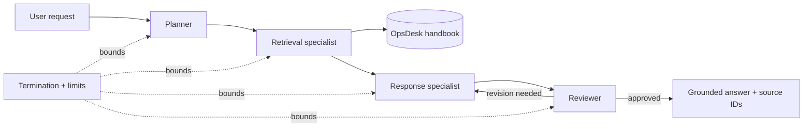

<div align="center">

# Multi Agents System with AutoGen

[](https://www.tertiarycourses.com.sg/multi-agents-system-with-autogen.html)
[](https://microsoft.github.io/autogen/stable/)
[](https://microsoft.github.io/autogen/stable/user-guide/agentchat-user-guide/)
[](#lab-activities)
[](#license)

**Concept-first courseware and connected labs for building grounded, bounded multi-agent applications with AutoGen AgentChat.**

[Course Page](https://www.tertiarycourses.com.sg/multi-agents-system-with-autogen.html) · [Learner Guide](LG-Multi%20Agents%20System%20with%20AutoGen%20%28C1034%29.md) · [Lab Index](labs/README.md) · [Report a Bug](https://github.com/tertiarycourses/C1034-Multi-Agents-System-with-Autogen/issues)

</div>

> [!NOTE]
> These are the official learning materials for **Multi Agents System with AutoGen**, course code **C1034**, by Tertiary Courses / Tertiary Infotech Academy.

## Lab Activities

All eight labs extend one synthetic **OpsDesk** scenario. The offline path uses AutoGen's replay model client so learners can verify architecture, messages, tools, retrieval and termination without spending model credits. Optional live runs read credentials only from local environment variables.

| # | Lab | Outcome |
|---:|---|---|
| 1 | [Verify AutoGen and Run a First Agent](labs/lab-01-verify-autogen-and-run-a-first-agent.md) | A reproducible environment report and first `AssistantAgent` trace |
| 2 | [Add a Typed Ticket Lookup Tool](labs/lab-02-add-a-typed-ticket-lookup-tool.md) | A read-only tool call with schema, event and result evidence |
| 3 | [Prepare a Source-Traceable Knowledge Index](labs/lab-03-prepare-a-source-traceable-knowledge-index.md) | Stable chunks with source identifiers and searchable tokens |
| 4 | [Evaluate Retrieval with Stable Questions](labs/lab-04-evaluate-retrieval-with-stable-questions.md) | Ranked retrieval evidence for known policy questions |
| 5 | [Build a Grounded RAG Agent](labs/lab-05-build-a-grounded-rag-agent.md) | A cited answer that refuses when evidence is insufficient |
| 6 | [Design Roles and Run a Round-Robin Team](labs/lab-06-design-roles-and-run-a-round-robin-team.md) | A writer-reviewer team with explicit completion and hard limits |
| 7 | [Route Specialists with SelectorGroupChat](labs/lab-07-route-specialists-with-selectorgroupchat.md) | A planner-retriever-writer-reviewer route with bounded selection |
| 8 | [Integrate and Verify the OpsDesk Workflow](labs/lab-08-integrate-and-verify-the-opsdesk-workflow.md) | An end-to-end regression pack and release-readiness record |

## About

This repository contains the aligned slide deck, Learner Guide, Lesson Plan and hands-on labs for **C1034 — Multi Agents System with AutoGen**. It follows the live course outline:

1. AutoGen, AgentChat and agent foundations, with a practical comparison to CrewAI concepts.
2. Retrieval-Augmented Generation, source-aware retrieval and grounded response design.
3. Multi-agent roles, team patterns, routing, termination, state and operational controls.

The materials target Python 3.10+ and AutoGen AgentChat 0.7.5. They distinguish the high-level AgentChat API from AutoGen Core and Studio, and they use the current `autogen_agentchat` and `autogen_ext` package layout.

### What you'll learn

| Learning outcome | Capability |
|---|---|
| LO1 | Explain LLM agents, the AgentChat execution model and when AutoGen or CrewAI abstractions fit |
| LO2 | Configure an `AssistantAgent`, model client, messages and a typed read-only tool |
| LO3 | Design a RAG pipeline with chunks, metadata, ranking and evidence-aware answer contracts |
| LO4 | Build and verify a grounded AgentChat assistant with citations and insufficient-evidence behaviour |
| LO5 | Select and implement round-robin and selector-based teams with explicit role and handoff contracts |
| LO6 | Bound, observe, test and operate a multi-agent workflow with termination, guardrails and recovery |

## Tech Stack

| Category | Technology |
|---|---|
| Agent framework | AutoGen AgentChat 0.7.5 |
| Model adapters | AutoGen Extensions; replay client offline and OpenAI client for optional live runs |
| Retrieval | Transparent local lexical index for teaching; production vector-memory options are explained in the guide |
| Language | Python 3.10+ with `asyncio` |
| Verification | Pytest, JSON evidence files and stable synthetic questions |
| Courseware | Single-source Python data modules rendered to PPTX, DOCX, PDF and Markdown |

## Architecture



## Project Structure

```text
C1034-Multi-Agents-System-with-Autogen/
├── README.md
├── LG-Multi Agents System with AutoGen (C1034).md
├── courseware/                 # PPTX/PDF slides, LG DOCX/PDF, LP DOCX/PDF
├── labs/                       # Eight detailed, connected lab guides
├── starter/                    # Executable OpsDesk lab kit and tests
└── .agents/skills/             # Course-specific single-source build data
```

## Getting Started

```bash
git clone https://github.com/tertiarycourses/C1034-Multi-Agents-System-with-Autogen.git
cd C1034-Multi-Agents-System-with-Autogen
python -m venv .venv
```

Activate the environment:

```powershell
# Windows PowerShell
.\.venv\Scripts\Activate.ps1
```

```bash
# macOS or Linux
source .venv/bin/activate
```

Install and verify:

```bash
python -m pip install -r starter/requirements.txt
python -m pip install -e starter
python -m opsdesk.cli setup
python -m pytest -q starter/tests
```

Run the fully offline learning path:

```bash
python -m opsdesk.cli first-agent --offline
python -m opsdesk.cli tool-agent --ticket INC-1001 --offline
python -m opsdesk.cli index
python -m opsdesk.cli retrieve --query "What approvals are required for VPN access?" --expect POL-VPN-01
python -m opsdesk.cli rag --query "What approvals are required for VPN access?" --offline
python -m opsdesk.cli team-contract-init --force
python -m opsdesk.cli team-contract-validate
python -m opsdesk.cli team-round-robin --offline
python -m opsdesk.cli team-selector --offline
python -m opsdesk.cli operations-init --force
python -m opsdesk.cli operations-validate
python -m opsdesk.cli safety-check
python -m opsdesk.cli release-check --offline
```

Complete the generated `.course_state/lab08-operations.md` record before the final release check; an unchanged template deliberately blocks `READY FOR GUIDED DEMO`. The editable install makes the `opsdesk` package available from the repository root on Windows, macOS and Linux. Every lab states the expected evidence for its checkpoint.

## Safe Use

- Use only the supplied synthetic incidents and policy text.
- Put real provider credentials in `.env` or an approved secret store; never in source, prompts, screenshots or Git.
- Keep tools read-only in the course environment.
- Treat retrieved content as untrusted data and preserve source identifiers in every grounded answer.
- Apply both a semantic completion condition and a hard message or time limit to every team.

## Contributing

Contributions and corrections are welcome. Create a focused branch, update the single-source modules and matching labs, rebuild all artifacts, run the quality checks, and open a pull request.

## License

This material is provided for educational use as part of course **C1034**. © Tertiary Infotech Academy Pte Ltd. All rights reserved.

## Developed By

**Tertiary Infotech Academy Pte Ltd** — [Tertiary Courses](https://www.tertiarycourses.com.sg/)
